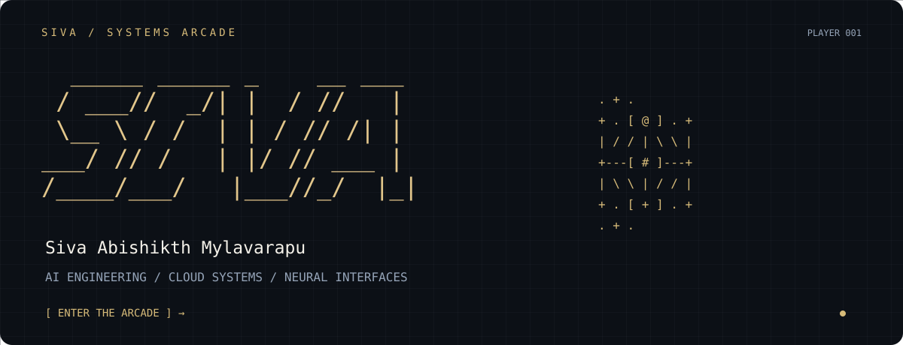

[](https://sivaabishikth2025-byte.github.io/sivaabishikth2025-byte/)

<p align="center"><b>AI engineer · Full-stack developer · Speaker & mentor</b><br>AWS 10,000 AI Ideas Winner · 6× Hackathon Winner · AWS ABWG Alumni</p>

<p align="center"><a href="https://sivaabishikth2025-byte.github.io/sivaabishikth2025-byte/"><b>▶ PLAY THE PORTFOLIO</b></a> &nbsp; / &nbsp; <a href="#mission-select">EXPLORE PROJECTS</a> &nbsp; / &nbsp; <a href="#current-research">CURRENT RESEARCH</a></p>

```text
> initialize player_001

  CLASS       AI + full-stack engineer
  FRONTIER    Autonomous drones / brain-controlled robotics
  RESEARCH    Neural decoding / visual reconstruction from EEG
  OBJECTIVE   Turn ambitious ideas into working systems.

  [@] YOU     [+] PROJECT NODE     [#] WALL
  Move. Explore. Collect six nodes. Discover the work behind them.
```

### Mission select

Explore a dossier below, or collect its node in the playable arcade.

<details>
<summary><b>01 / Sift</b> — Python / AWS</summary>

An always-on AI signal analyst.

[Explore source →](https://github.com/sivaabishikth2025-byte/sift-agent)

</details>

<details>
<summary><b>02 / PricePilot</b> — Python / AI</summary>

An AI price-drop watchdog.

[Explore source →](https://github.com/sivaabishikth2025-byte/pricepilot)

</details>

<details>
<summary><b>03 / Infinite Mashup Studio</b> — TypeScript / Bedrock</summary>

Fuse impossible inventions with Bedrock.

[Explore source →](https://github.com/sivaabishikth2025-byte/infinite-mashup-studio)

</details>

<details>
<summary><b>04 / Prompt Injection Detector</b> — JavaScript / Chrome</summary>

Local browser protection for AI workflows.

[Explore source →](https://github.com/sivaabishikth2025-byte/prompt-injection-detector)

</details>

<details>
<summary><b>05 / PocketLedger</b> — JavaScript / Serverless</summary>

An expense logger built on AWS.

[Explore source →](https://github.com/sivaabishikth2025-byte/pocketledger)

</details>

<details>
<summary><b>06 / Pet Agents</b> — TypeScript / Agents</summary>

AI pets and an agent command center.

[Explore source →](https://github.com/sivaabishikth2025-byte/pet-agents)

</details>

### Current research

I’m working on autonomous drones, brain-controlled robotics, and neural decoding—particularly reconstructing visual data from EEG using BCI and AI. I’m interested in collaborating on neural decoding and EEG-based visual reconstruction.

---
<sub>The arcade is a playable map of selected projects. Progress is stored in your browser; the GitHub profile itself uses native Markdown interactions.</sub>
